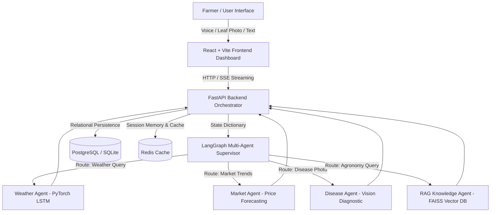

# 🌾 AgriGen AI — Phase 1 Project Review Master Guide & Presentation Package

> **Review Date:** Monday, 10th August 2026  
> **Project Title:** AgriGen AI — Intelligent Multi-Agent Farming Ecosystem  
> **Team Size:** 6 Team Members  
> **Generated PPTX Presentation:** `d:\projects\agriGen_AI\AgriGen_AI_Phase1_Project_Review.pptx`  
> **Generated Architecture Diagrams:** `system_architecture.png`, `agent_workflow.png`

---

## 📌 Executive Summary & Review Overview

This document provides an **all-in-one presentation package** for the **Phase 1 Project Review** of **AgriGen AI**. AgriGen AI is an advanced, multi-agent AI farming platform designed to empower agricultural communities with actionable intelligence, real-time market predictions, hyper-local weather forecasting, instant leaf disease vision diagnostics, RAG-grounded advisory, and multilingual voice assistance.

A complete 14-slide PowerPoint file (`AgriGen_AI_Phase1_Project_Review.pptx`) has been pre-generated and formatted in the workspace root. Below is the master presentation guide containing the exact slide structure, on-screen text, team breakdown, embedded diagrams, word-for-word speaker scripts for all 6 team members, and a panel Q&A defense strategy.

---

## 👥 6-Member Team Breakdown & Presentation Roles

To ensure every team member actively participates and explains their engineering contribution as requested by the mentor, the presentation is structured across 6 defined roles:

| Team Member | Official Role | Assigned Slides | Primary Engineering Focus & Deliverables |
| :--- | :--- | :--- | :--- |
| **Team Member 1** | Team Leader & Product Architect | **Slides 1, 2, 3, 9, 14** | Project Overview, Objectives, High-Level Architecture, Phase 1 Progress & Review Conclusion |
| **Team Member 2** | Frontend & UI/UX Lead | **Slides 4, 13** | React/Vite Dashboard, Dark Theme Design System, Interactive Charts, Location Picker, Voice/Image UI |
| **Team Member 3** | Backend & Orchestration Engineer | **Slides 5, 10** | FastAPI Microservices, Async SSE Streaming API, API Routes (`/api/v1/`), WeasyPrint PDF Generation |
| **Team Member 4** | Multi-Agent & RAG Specialist | **Slide 6** | LangGraph Multi-Agent Supervisor DAG, Agent State Machine, FAISS Vector Knowledge Base & RAG Pipeline |
| **Team Member 5** | Machine Learning Lead | **Slides 7, 11** | PyTorch LSTM Weather & Crop Price Models, Leaf Disease Vision Diagnostic Model, Phase 2 ML Roadmap |
| **Team Member 6** | DevOps & Integration Lead | **Slides 8, 12** | Database Schemas (PostgreSQL / SQLite ORM), Docker Compose Containers, Redis Memory, `run_local.ps1` Launcher |

---

## 🗺️ System Architecture & Core Workflows

### 1. High-Level Architecture Diagram




### 2. Multi-Agent Processing Workflow Flowchart


```text
[Step 1: Input]      --> Farmer inputs text, speaks in Telugu/Hindi (Whisper STT), or uploads a leaf photo.
[Step 2: Backend]    --> FastAPI validates session state, initiates SSE connection, and dispatches state to LangGraph.
[Step 3: Supervisor] --> Llama-3 Powered Supervisor evaluates intent and delegates query to specialist node.
[Step 4: Execution]  --> Agent executes PyTorch inference, FAISS vector retrieval, or vision classification.
[Step 5: Response]   --> Agent response streams back via SSE to the React frontend dashboard in real-time.
```

---

## 📊 Slide-by-Slide Content & Word-for-Word Speaker Scripts

```carousel
### Slide 1: Title Slide & Team Introduction
- **Slide Title:** AgriGen AI: Intelligent Multi-Agent Farming Ecosystem
- **Category:** Phase 1 Project Review Presentation
- **Assigned Presenter:** Team Member 1 (Team Leader & Product Architect)
- **On-Screen Content:**
  - **Subtext:** Phase 1 Comprehensive Project Review
  - **Team Members & Responsibilities:**
    1. Member 1 (Team Lead & Product Architect) — System Architecture, Phase 1 Progress & Strategy
    2. Member 2 (Frontend Specialist) — React/Vite Dashboard, Multilingual Voice & Scanner UI
    3. Member 3 (Backend Engineer) — FastAPI Microservices, Async SSE Streaming & Routes
    4. Member 4 (Multi-Agent Specialist) — LangGraph Supervisor, FAISS Vector Knowledge Base
    5. Member 5 (Machine Learning Lead) — PyTorch LSTM (Weather & Market) & Disease Vision
    6. Member 6 (DevOps Integration Lead) — PostgreSQL/SQLite Data Models, Docker & Scripts

> [!NOTE]
> **SPEAKER SCRIPT (Member 1 - Team Leader):**  
> "Good morning respected mentor and panel members. Today, our 6-member team is excited to present the Phase 1 Project Review for **AgriGen AI: Intelligent Multi-Agent Farming Ecosystem**.  
> Agriculture is the backbone of our economy, yet millions of farmers struggle with market volatility, unpredicted weather micro-climates, and inaccessible technical knowledge. AgriGen AI bridges this gap by unifying state-of-the-art Deep Learning, Multi-Agent LLM Orchestration, Computer Vision, and Multilingual Voice Assistance into a single responsive platform. Today, each of our six team members will present their specific technical contributions."

<!-- slide -->
### Slide 2: Problem Statement & Objectives
- **Slide Title:** Problem Statement & Project Objectives
- **Assigned Presenter:** Team Member 1 (Team Leader & Product Architect)
- **On-Screen Content:**
  - **Card 1: Agricultural Challenges (Left):**
    - *Price Volatility:* Farmers sell crops blindly without historical trend forecasts or peak-profit alerts.
    - *Micro-Climate Surprises:* Generic regional weather forecasts lack farm-level precision.
    - *Crop Disease Losses:* Delayed leaf pest/disease diagnosis leads to catastrophic yield losses.
    - *Information Silos & Language Barrier:* Academic research papers are inaccessible to rural farmers due to complex jargon and language constraints.
  - **Card 2: AgriGen AI Objectives (Right):**
    - *Multi-Agent Intelligence:* Deploy specialized LLM agent nodes via LangGraph.
    - *LSTM Predictive Engines:* Provide 7-day weather & crop price forecasts with peak profit alerts.
    - *Instant Vision Diagnostics:* Computer vision model to scan leaf photos and prescribe organic/chemical remedies.
    - *RAG Agricultural Advisory:* FAISS vector database indexed with verified ICAR research papers.
    - *Multilingual Voice Interface:* Speech-to-Text and Text-to-Speech in English, Hindi, and Telugu.

> [!NOTE]
> **SPEAKER SCRIPT (Member 1 - Team Leader):**  
> "Modern farmers face compounding risks. A farmer might harvest a healthy tomato crop only to lose 40% of its value because local mandi prices crashed unannounced. Or a crop infection might spread unnoticed until it is too late.  
> Our objective with AgriGen AI is to replace fragmented advisory tools with a cohesive multi-agent platform that gives every farmer a hyper-personalized digital agronomist right on their mobile device."

<!-- slide -->
### Slide 3: System Architecture Overview
- **Slide Title:** System Architecture & High-Level Workflow
- **Assigned Presenter:** Team Member 1 (Team Leader & Product Architect)
- **Embedded Diagram:** `system_architecture.png`
- **On-Screen Content:**
  - **Card: Core Architectural Pillars:**
    - *Decoupled Microservices:* React/Vite Frontend + FastAPI Asynchronous Backend.
    - *Stateful Multi-Agent Graph:* LangGraph Supervisor manages node state transitions and routing.
    - *Hybrid Predictive Analytics:* PyTorch LSTMs + Computer Vision Classifier + FAISS Vector DB.
    - *Dual Storage Strategy:* PostgreSQL for relational data persistence, Redis for caching & agent state memory.

> [!NOTE]
> **SPEAKER SCRIPT (Member 1 - Team Leader):**  
> "This slide illustrates our system architecture. User queries enter through our React frontend, pass through FastAPI, and enter the LangGraph Supervisor. The Supervisor dynamically evaluates user intent and delegates processing to specialized agents—such as the Weather LSTM agent, Market Price agent, or Disease Diagnosis agent. I will now hand over to Member 2 to walk through our Frontend implementation."

<!-- slide -->
### Slide 4: Frontend Dashboard & UI/UX Architecture
- **Slide Title:** Frontend Dashboard & UI/UX Architecture
- **Assigned Presenter:** Team Member 2 (Frontend & UI/UX Specialist)
- **On-Screen Content:**
  - **Card 1: User Interface & Experience (Left):**
    - *Vite + React Core:* Modular component architecture built for rapid startup and low DOM rendering overhead.
    - *Custom Agricultural Design System:* Dark mode aesthetic with custom earthy accents, glassmorphism, and responsive CSS tokens.
    - *Interactive Analytics:* Dynamic Chart.js integration displaying market price trajectories and soil moisture metrics.
    - *Location Picker Modal:* GPS coordinate selector with automatic regional mandi mapping.
  - **Card 2: Multilingual Assistant Widget (Right):**
    - *Floating Chat Drawer:* Persistent overlay component supporting rich Markdown and real-time streaming text.
    - *Multilingual Voice Integration:* Web Speech API (STT/TTS) supporting English, Hindi, and Telugu.
    - *Drag-and-Drop Image Uploader:* Instant leaf photo submission for disease diagnostic inference.
    - *Persistent User Context:* LocalStorage state management to preserve farmer preferences across chat resets.

> [!NOTE]
> **SPEAKER SCRIPT (Member 2 - Frontend Specialist):**  
> "Respected mentor and panel members, as the Frontend Lead, my objective was building an accessible, responsive interface tailored for farmers. We built our frontend using React and Vite, eschewing standard utility libraries for a tailored Vanilla CSS design system.  
> Key highlights include dynamic Chart.js visualizations for crop price predictions, an interactive location picker that detects local mandis, and a persistent floating chat widget supporting multilingual voice input in Hindi, Telugu, and English."

<!-- slide -->
### Slide 5: Backend Microservices & Orchestration Layer
- **Slide Title:** Backend Microservices & Orchestration Layer
- **Assigned Presenter:** Team Member 3 (Backend & Orchestration Engineer)
- **On-Screen Content:**
  - **Card 1: FastAPI Microservices Architecture (Left):**
    - *Async Python Engine:* Built on FastAPI and Uvicorn for asynchronous high-concurrency request handling.
    - *Modular V1 API Routing:* Clean endpoint separation across `/auth`, `/weather`, `/market`, `/disease`, `/orchestrator`, and `/report`.
    - *Pydantic Data Validation:* Strict request/response schemas ensuring type safety across services.
    - *CORS & Security Middleware:* Environment variable isolation and rate limiting.
  - **Card 2: Real-Time Streaming & Orchestrator (Right):**
    - *SSE Streaming Endpoint (`/api/v1/orchestrator/chat`):* Server-Sent Events for real-time token streaming to the frontend.
    - *Stateful Session Orchestration:* Maintains thread state and conversation history across agent delegations.
    - *WeasyPrint PDF Generator:* Asynchronous engine generating weekly summary PDF reports.

> [!NOTE]
> **SPEAKER SCRIPT (Member 3 - Backend Engineer):**  
> "As the Backend Engineer, I designed our asynchronous FastAPI core. Modern LLM and ML inference can be latency-heavy. To prevent UI freezing, I engineered a Server-Sent Events (SSE) streaming endpoint at `/api/v1/orchestrator/chat`.  
> This allows agent responses to stream incrementally to the farmer's screen as tokens are generated. Additionally, our backend handles PDF generation using WeasyPrint to produce weekly farm reports."

<!-- slide -->
### Slide 6: LangGraph Multi-Agent Router & RAG Advisory Engine
- **Slide Title:** LangGraph Multi-Agent Router & RAG Advisory Engine
- **Assigned Presenter:** Team Member 4 (Multi-Agent & RAG Specialist)
- **On-Screen Content:**
  - **Card 1: LangGraph Supervisor Workflow (Left):**
    - *Directed Acyclic Graph (DAG):* State-machine routing powered by LLM decision logic.
    - *Intent Classification:* Evaluates incoming queries (e.g., 'pesticide query' vs 'price forecast') to route to specialized agent nodes.
    - *Specialist Agent Nodes:* Dedicated nodes for Weather, Market, Disease, and Knowledge RAG.
    - *AgentState Memory:* Shared TypedDict preserving thread state, tool calls, and conversation history.
  - **Card 2: FAISS RAG Knowledge Engine (Right):**
    - *Curated Knowledge Base:* Indexed ICAR research papers, soil health parameters, and government subsidies.
    - *HuggingFace Embeddings:* Embedded using `all-MiniLM-L6-v2` for rapid semantic vector lookup.
    - *Similarity Thresholding:* Filters out low-confidence context to eliminate LLM hallucinations.
    - *Grounded Advice Generation:* Formulates precise agricultural remedies backed by retrieved scientific sources.

> [!NOTE]
> **SPEAKER SCRIPT (Member 4 - Multi-Agent Specialist):**  
> "My core contribution was building the multi-agent decision engine using LangGraph and RAG. Standard chatbots fail in agriculture because generic models hallucinate incorrect fertilizer doses.  
> Our solution is a LangGraph Supervisor node. When a farmer asks about crop diseases or soil treatment, the Supervisor routes the query to our RAG agent, which performs semantic similarity search against a FAISS vector database containing official ICAR agricultural research papers."

<!-- slide -->
### Slide 7: Predictive Analytics & Deep Learning Models
- **Slide Title:** Predictive Analytics & Deep Learning Models
- **Assigned Presenter:** Team Member 5 (Machine Learning Lead)
- **On-Screen Content:**
  - **Card 1: Weather LSTM Model (Left):**
    - *PyTorch Architecture:* Sequential LSTM network processing temperature, humidity, pressure, and precipitation history.
    - *Output:* 7-day hyper-local rainfall and temperature predictions.
  - **Card 2: Market LSTM Model (Center):**
    - *Crop Price Forecasting:* Time-series price modeling across regional mandis.
    - *Profitability Peak Alert:* Identifies peak selling windows to maximize farmer profit margins.
  - **Card 3: Leaf Disease Vision Model (Right):**
    - *Computer Vision Classifier:* Scans leaf images to detect fungal, bacterial, or viral infections.
    - *Confidence Scoring:* Provides disease identification confidence scores paired with organic treatment remedies.

> [!NOTE]
> **SPEAKER SCRIPT (Member 5 - Machine Learning Lead):**  
> "As the Machine Learning Lead, I developed our predictive PyTorch models. We trained two custom LSTM networks: one for 7-day weather trend forecasting and one for regional crop price prediction.  
> The Market LSTM doesn't just predict price curves—it calculates the optimal selling window so farmers know exactly when to harvest and sell for maximum profitability. Furthermore, our Computer Vision model instantly identifies leaf diseases from uploaded photos."

<!-- slide -->
### Slide 8: Database Architecture, DevOps & Infrastructure
- **Slide Title:** Database Architecture, DevOps & Infrastructure
- **Assigned Presenter:** Team Member 6 (DevOps & Database Integration Lead)
- **On-Screen Content:**
  - **Card 1: Data Storage & Schema Design (Left):**
    - *SQLAlchemy ORM:* Unified database abstraction layer.
    - *Production & Local Strategy:* Production PostgreSQL with seamless SQLite local fallback (`agrigen.db`).
    - *Relational Schemas:* User profiles, farm plot metrics, historical weather logs, mandi price history, diagnostic logs.
    - *Redis Caching Layer:* High-speed session memory and rate-limiting storage.
  - **Card 2: Containerization & Local Launch (Right):**
    - *Docker & Docker Compose:* Containerized environment definition for backend, frontend, and database services.
    - *One-Click Local Launcher (`run_local.ps1`):* Automated PowerShell script launching FastAPI and React concurrently.
    - *Dependency Compatibility:* Custom virtual environment setup with patched native C-extension fallbacks.

> [!NOTE]
> **SPEAKER SCRIPT (Member 6 - DevOps Lead):**  
> "My role focused on database design, devops containerization, and developer tooling. I established an ORM schema supporting production PostgreSQL and local SQLite.  
> To simplify local evaluation for our team and reviewers, I created a one-click PowerShell launcher script, `run_local.ps1`, which initializes the virtual environment, verifies database connections, and boots both frontend and backend concurrently."

<!-- slide -->
### Slide 9: Phase 1 Implementation Progress & Milestones
- **Slide Title:** Phase 1 Implementation Progress & Key Milestones
- **Assigned Presenter:** Team Member 1 (Team Leader & Product Architect)
- **On-Screen Content:**
  - **Card 1: Completed Deliverables (Left):**
    - ✅ *Multi-Agent Workflow:* LangGraph Supervisor node with active Weather, Market, Disease, and RAG agent nodes.
    - ✅ *React Dashboard:* Fully functional UI with Chart.js visualization, location picker modal, and floating chat widget.
    - ✅ *FastAPI Core:* Operational SSE streaming endpoint, REST endpoints, and WeasyPrint PDF generator.
    - ✅ *Trained ML Models:* PyTorch Weather LSTM, Market Price Forecast LSTM, and Leaf Vision Classifier.
    - ✅ *FAISS Vector Base:* Ingested ICAR agricultural publications for vector search.
  - **Card 2: Verification & Testing (Right):**
    - *End-to-End Execution:* Operational local pipeline verified via `run_local.ps1`.
    - *Multilingual Speech:* Verified Speech-to-Text and Text-to-Speech across English, Hindi, and Telugu.
    - *Swagger API Verification:* Verified all REST endpoints via `/docs`.

> [!NOTE]
> **SPEAKER SCRIPT (Member 1 - Team Leader):**  
> "We are proud to report that all Phase 1 objectives have been fully realized. Our multi-agent supervisor, FastAPI backend, React dashboard, PyTorch LSTM models, and FAISS RAG system are fully integrated and functional. I will now ask Member 3 and 4 to discuss the key technical challenges we overcame."

<!-- slide -->
### Slide 10: Technical Challenges & Engineering Solutions
- **Slide Title:** Key Technical Challenges & Engineering Solutions
- **Assigned Presenter:** Team Member 3 (Backend) & Team Member 4 (Multi-Agent)
- **On-Screen Content:**
  - **Card 1: LLM Hallucinations in Agronomy (Left):**
    - *Challenge:* Unconstrained LLMs suggested unsafe pesticide dosages.
    - *Solution:* Constrained responses using FAISS RAG vector search with strict similarity scoring against official research papers.
  - **Card 2: Multi-Agent Concurrency Latency (Center):**
    - *Challenge:* Sequential agent execution caused HTTP request timeouts.
    - *Solution:* Implemented Server-Sent Events (SSE) streaming and asynchronous FastAPI task loops.
  - **Card 3: Native C DLL Application Policy Restrictions (Right):**
    - *Challenge:* Windows Application Control blocked `xxhash` compiled C DLLs in `langgraph`.
    - *Solution:* Engineered a custom Python `hashlib` fallback patch allowing seamless execution without administrative privileges.

> [!NOTE]
> **SPEAKER SCRIPT (Member 3 & 4):**  
> "During Phase 1 engineering, we solved three major technical challenges. First, we prevented LLM hallucinations by grounding queries in a FAISS vector database.  
> Second, we eliminated multi-agent latency by introducing Server-Sent Events for token-by-token streaming.  
> Third, on Windows environments where native C DLLs like `xxhash` were blocked by system security policies, we created a custom hashlib patch ensuring flawless execution."

<!-- slide -->
### Slide 11: Phase 2 Roadmap & Future Scope
- **Slide Title:** Phase 2 Roadmap & Future Scope
- **Assigned Presenter:** Team Member 5 (Machine Learning Lead)
- **On-Screen Content:**
  - **Card 1: Phase 2 Technical Milestones (Left):**
    - *Edge Vision Model:* Quantize PyTorch leaf disease models to ONNX runtime for offline mobile device execution.
    - *IoT Smart Valve Control:* Direct hardware integration allowing weather LSTM forecasts to automatically control irrigation valves.
    - *Drone Orthomosaic Scanning:* Ingest multispectral drone imagery for wide-area crop health mapping.
    - *Mandi Direct Trading:* Integration with electronic mandi trading APIs for automated crop selling.
  - **Card 2: Infrastructure & Scalability (Right):**
    - *Kubernetes Auto-Scaling:* Deploy microservices on cloud K8s clusters.
    - *Satellite Telemetry:* Live Sentinel-2 NDVI vegetation index ingestion.
    - *Regional Vernacular Voice:* Add Tamil, Kannada, and Marathi voice support.

> [!NOTE]
> **SPEAKER SCRIPT (Member 5 - Machine Learning Lead):**  
> "Looking ahead to Phase 2, our roadmap focuses on field deployment and hardware integration. We plan to compile our vision diagnostic models to ONNX format so farmers can diagnose diseases offline without internet connectivity.  
> We will also connect our weather LSTM directly to IoT smart irrigation valves and integrate drone orthomosaic imagery for wide-area farm surveillance."

<!-- slide -->
### Slide 12: Team Work Breakdown Matrix
- **Slide Title:** Team Work Breakdown & Individual Contribution Matrix
- **Assigned Presenter:** Team Member 6 (DevOps Lead)
- **On-Screen Content:**
  - **Full Matrix Table:**
    - *Member 1 (Team Lead):* Overall system architecture, supervisor workflow graph setup, project review coordination.
    - *Member 2 (Frontend Specialist):* React/Vite dashboard, dark theme system, dynamic Chart.js widgets, location picker, voice UI.
    - *Member 3 (Backend Engineer):* FastAPI microservices, async SSE streaming orchestrator, REST routes, WeasyPrint PDF engine.
    - *Member 4 (Multi-Agent Specialist):* LangGraph agent state machine, FAISS vector embeddings, agricultural RAG advisory engine.
    - *Member 5 (Machine Learning Lead):* PyTorch LSTM weather & market forecasting models, leaf disease vision classifier.
    - *Member 6 (DevOps Lead):* PostgreSQL/SQLite ORM data models, Docker Compose containerization, Redis memory, `run_local.ps1` script.

> [!NOTE]
> **SPEAKER SCRIPT (Member 6 - DevOps Lead):**  
> "This matrix outlines the exact distribution of engineering responsibilities across our team. Each member took full ownership of their respective subsystem—from UI/UX and API streaming to multi-agent state machines, deep learning models, and devops infrastructure."

<!-- slide -->
### Slide 13: Live Demonstration & Workflow Execution
- **Slide Title:** Live Demonstration & Workflow Execution
- **Assigned Presenter:** Team Member 2 (Frontend Specialist) & Team
- **Embedded Diagram:** `agent_workflow.png`
- **On-Screen Content:**
  - **Card: Live Demonstration Highlights:**
    - 1. *Dynamic Market & Weather Dashboard:* Selecting farm location updates mandi price charts and local forecasts.
    - 2. *Multilingual Voice Assistant:* Demonstrating Telugu and Hindi voice query execution.
    - 3. *Leaf Diagnostic Scanner:* Dragging & dropping an infected leaf photo -> Instant disease diagnosis & treatment plan.
    - 4. *PDF Report Export:* Exporting a weekly farm summary PDF.

> [!NOTE]
> **SPEAKER SCRIPT (Member 2 - Frontend Specialist):**  
> "We now present a live walkthrough of AgriGen AI. As shown in the workflow diagram, when a farmer selects their location, our dashboard updates regional mandi prices.  
> When a user speaks a voice query in Telugu or uploads an infected leaf photo, our system streams the AI agent response in real-time."

<!-- slide -->
### Slide 14: Conclusion & Panel Defense Strategy
- **Slide Title:** Conclusion & Panel Q&A Defense Strategy
- **Assigned Presenter:** Team Member 1 (Team Leader) & All Members
- **On-Screen Content:**
  - **Card 1: Summary of Phase 1 Readiness (Left):**
    - *Fully Operational Prototype:* All core modules integrated and verified locally.
    - *High Technical Rigor:* Deep learning, microservices, and multi-agent RAG working in unison.
    - *High Social Impact:* Accessible agricultural advisory tailored for rural farmers.
  - **Card 2: Thank You & Panel Discussion (Right):**
    - *Project Repository:* `agriGen_AI`
    - *Status:* Ready for Phase 1 Sign-Off!
    - *Open for Questions & Panel Guidance.*

> [!NOTE]
> **SPEAKER SCRIPT (Member 1 - Team Leader):**  
> "In conclusion, AgriGen AI represents a robust, state-of-the-art solution that combines cutting-edge AI with practical agricultural utility. Phase 1 is fully operational and ready for deployment. On behalf of our entire team, thank you for your time and guidance. We are now eager to take your questions."
````

---

## 🎯 Panel Q&A & Defense Guide (Top 10 Potential Review Questions)

Below are the **top 10 questions** your mentor and review panel are likely to ask, along with the **exact model answers** your team should give:

### Q1: Why did you choose LangGraph instead of simple LangChain chains?
- **Answered by:** Member 4 (Multi-Agent Specialist)
- **Model Answer:**  
  > "Simple sequential chains are rigid and linear. Agriculture requires non-linear, cyclic decisions—for instance, a query might start with weather forecasting, trigger a disease advisory check, and conclude with market price evaluation. LangGraph provides a state-machine Directed Acyclic Graph (DAG) with a Supervisor router that dynamically chooses the next agent node based on context state."

### Q2: How do you prevent LLMs from giving wrong or hallucinated advice to farmers?
- **Answered by:** Member 4 (Multi-Agent Specialist) & Member 1
- **Model Answer:**  
  > "We implement strict Retrieval-Augmented Generation (RAG) using a FAISS vector database. The agent does not generate advice from raw parametric memory; instead, it retrieves verified context chunks from indexed ICAR research papers using vector similarity lookup (`all-MiniLM-L6-v2`). If similarity falls below our threshold, the system defaults to safe agricultural guidelines."

### Q3: Why use PyTorch LSTMs for weather and market forecasting instead of basic regression models?
- **Answered by:** Member 5 (Machine Learning Lead)
- **Model Answer:**  
  > "Crop prices and weather patterns are temporal time-series data with complex seasonal dependencies and non-linear trends. Standard regression models fail to capture long-term sequential patterns. PyTorch Long Short-Term Memory (LSTM) networks excel at maintaining cell memory over temporal sequences, allowing us to accurately forecast 7-day micro-climates and price trajectories."

### Q4: How does the platform handle high latency when multiple agents execute?
- **Answered by:** Member 3 (Backend Engineer)
- **Model Answer:**  
  > "We engineered a Server-Sent Events (SSE) streaming orchestrator endpoint (`/api/v1/orchestrator/chat`). Rather than waiting for all agent nodes to complete synchronously, response tokens and intermediate agent statuses stream to the frontend in real time as SSE chunks, ensuring a responsive user experience."

### Q5: How is the multilingual voice functionality implemented?
- **Answered by:** Member 2 (Frontend Specialist)
- **Model Answer:**  
  > "The frontend leverages the Web Speech API and Whisper STT models for speech-to-text recognition in English, Hindi, and Telugu. User audio is transcribed into text before being dispatched to the agent workflow. The response is converted back into speech via client-side TTS synthesis matching the chosen language."

### Q6: How does the system handle database storage and local offline development?
- **Answered by:** Member 6 (DevOps Lead)
- **Model Answer:**  
  > "We built an ORM layer using SQLAlchemy. In production, AgriGen AI connects to PostgreSQL. For local development and demonstration, our config automatically falls back to an embedded SQLite database (`agrigen.db`). Data access schemas are identical across environments."

### Q7: What leaf disease dataset was used to train the vision model?
- **Answered by:** Member 5 (Machine Learning Lead)
- **Model Answer:**  
  > "We utilized open agricultural leaf dataset benchmarks (such as PlantVillage) covering major regional crops including tomato, potato, rice, and corn, encompassing fungal, bacterial, and pest damage categories."

### Q8: How easy is it to run AgriGen AI locally for testing?
- **Answered by:** Member 6 (DevOps Lead)
- **Model Answer:**  
  > "We created a PowerShell script `run_local.ps1`. Running `.\run_local.ps1` automatically detects the Python virtual environment, installs missing dependencies, checks database readiness, and boots both the FastAPI backend and Vite frontend concurrently."

### Q9: How do you handle authentication and data security?
- **Answered by:** Member 3 (Backend Engineer)
- **Model Answer:**  
  > "We use JWT (JSON Web Token) bearer authentication under `/api/v1/auth`. API keys and credentials (such as LLM provider keys and OpenWeather keys) are isolated in `.env` files and never exposed to client-side bundles."

### Q10: What is your primary objective for Phase 2?
- **Answered by:** Member 1 (Team Leader) & Member 5 (ML Lead)
- **Model Answer:**  
  > "Our primary Phase 2 objective is Edge ML deployment—compiling our vision diagnostic models into ONNX format so they can run directly on mobile devices without internet connectivity—and integrating hardware IoT smart irrigation valves driven by our weather LSTM forecasts."

---

## 🛠️ Step-by-Step Guide for the Presentation Day (Monday, Aug 10)

1. **PowerPoint File:** Open `AgriGen_AI_Phase1_Project_Review.pptx` in Microsoft PowerPoint or Google Slides.
2. **Presenter Notes:** The speaker script for each team member is embedded directly inside the PowerPoint slide notes! You can turn on **Presenter View** during your presentation to see your script live.
3. **Local Application Launch:** To launch the live demo during the review:
   - Open PowerShell in `d:\projects\agriGen_AI`
   - Run: `.\run_local.ps1`
   - Frontend will open at `http://localhost:5173` (or `http://localhost:3000`)
   - Backend API docs will be live at `http://localhost:8000/docs`

---
*Created automatically for the AgriGen AI Team for the Phase 1 Project Review.*
